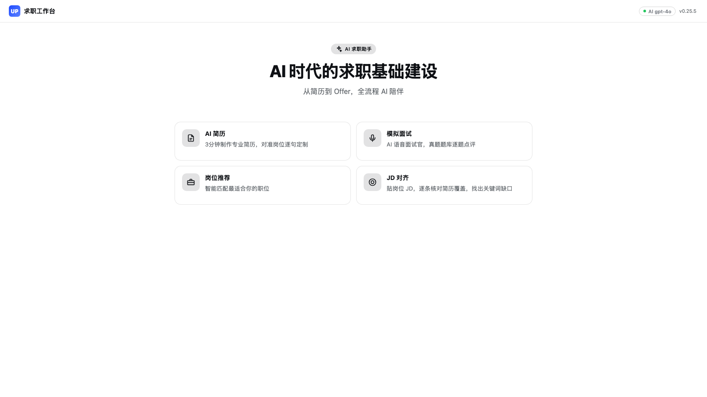
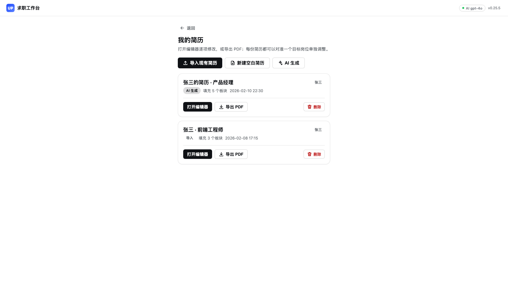
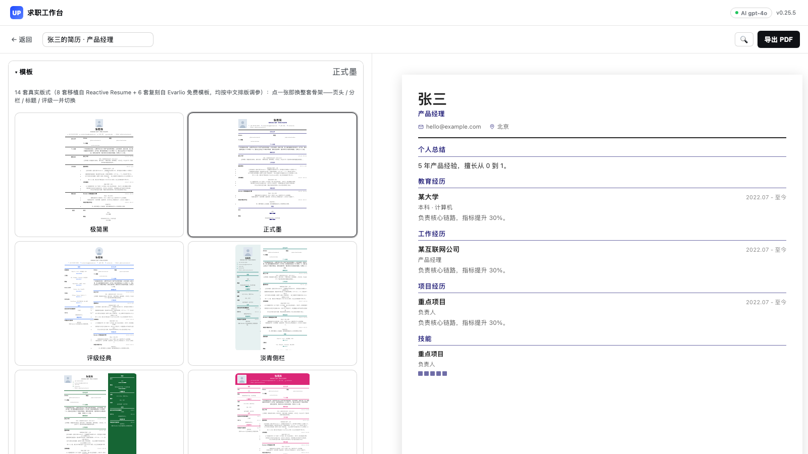
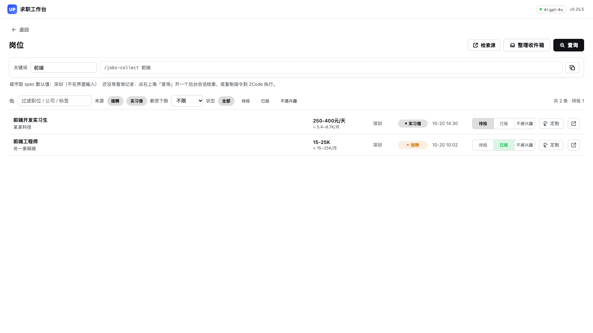
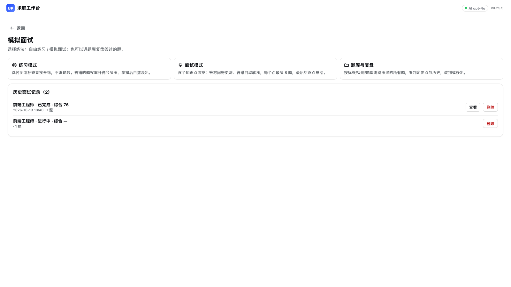

# DSH UPCV 求职工作台插件

面向求职场景的 DSH Desktop 工作台（界面设计参考 [upcv.tech](https://www.upcv.tech)）

## 功能

- **导入现有简历** — PDF / DOCX / 文本 → AI 拆成可逐项编辑的结构
- **可视化简历编辑器** — 14 个板块逐项编辑、14 套模板 + 色板 + 排版设置、A4 实时预览、防抖自动保存、导出 PDF
- **新建空白简历** — 按内置空白 schema 从零填写
- AI 生成简历 — 给原始素材，AI 对准目标岗位重写并生成可编辑简历
- 模拟面试 — 两种练法：**练习模式**（选简历或标签直接开练、不限题数、答错多练答对淡出）或**面试模式**（逐知识点深挖：答对问深、答错转浅，每点最多 8 题，结束给逐点总结；内置 300 题兜底）
- **题库与复盘（0.19-0.20）** — 面试出过的题自动沉淀入题库：每题带技术栈/级别/题型三维标签与判定要点；
  答错权重升高出现更频繁，答对衰减自然淡出（不用专门刷错题）；判定逐条对照要点给出命中率与「更优做法」反馈；
  简历首次练习时自动提取知识点、按深度阶梯批量生成个性化题库（含结合项目的实战题），简历更新后增量补题；
  JD 面试优先复用题库高权重题（先抽后补）；某标签题量不足时后台自动扩充，题库页也可手动补充；
  防挫败与防背答案（0.21.0）：连续答错 3 次自动生成更基础的台阶题，反复停留在「能用」层自动补最佳实践专题题，
  连续答对 2 次的题再出现时自动换成同考点变体（换问法防背答案）
- **真实岗位检索** — 内建采集器按 `jobs-spec.json` 逐渠道检索、去重入库、本地筛选与直链投递；也可把指令交给 ZCode/Codex
- **JD 对齐** — 贴岗位 JD，逐条核对简历覆盖，列出 ATS 关键词缺口与改写建议
- 校招信息聚合 — 对接 upcv.tech 公开校招接口（界面待接入）

## 简历模板（14 套）

编辑器里一键换整套版式。每套自带默认主色与 6-8 个预设色板，主题色可以独立调整（换色不动版式）。
版面按中文排版习惯调参：字体栈 `PingFang SC` / `Noto Sans SC` 优先、正文行高 1.5-1.6、
标题用**字重 + 字距**做层级（不用斜体）、照片位可显隐。

### Reactive Resume 移植组（8 套）

| 模板 id | 中文名 | 骨架 |
|---------|--------|------|
| `rr-bronzor` | 极简黑 | 居中页头（照片在上）+ 左侧标签行式板块；圆点评级 |
| `rr-onyx` | 正式墨 | 左照片页头 + 单栏；标题带分隔线；方形评级 |
| `rr-azurill` | 评级经典 | 居中页头 + 左技能栏；星级评级 |
| `rr-glalie` | 淡青侧栏 | 左浅青侧栏（照片/联系/证书/兴趣）+ 右主栏 |
| `rr-chikorita` | 翠绿侧栏 | 左主栏 + **右侧**彩色栏；条形评级 |
| `rr-ditto` | 横幅粉 | 顶部全宽彩色横幅 + 下方双栏；进度条评级 |
| `rr-lapras` | 云卡片 | 浅底 + 白色圆角卡片分块；方形评级 |
| `rr-porygon` | 结构蓝 | 白卡页头 + 表格化联系行 + 深色标题条；星级评级 |

### Evarlio 复刻组（6 套，2026-11）

按 [Evarlio](https://evarlio.com/resume-templates) 免费模板的**设计观感**复刻（配色 / 栏比 / 标题体系
取自其预览 DOM 实测值），代码全部自写；编号节标题每页重新计数（CSS counter 的已知限制）。

| 模板 id | 中文名 | 复刻自 | 骨架 |
|---------|--------|--------|------|
| `rr-docket` | 卷宗编号 | Civic Docket | 米白纸底 + 衬线 + 「1.」编号节标题；单栏 |
| `rr-ink` | 宣纸衬线 | Inkawake | 米黄纸底 + 青瓷衬线节标题（正文无衬线的混排）；单栏 |
| `rr-glyph` | 双列编号 | Glyphlab | 暖白纸底 + 双列均分 + 「01」编号节标题 |
| `rr-meadow` | 绿茵图标 | Meadow | 左淡绿侧栏 + 图标节标题；30/70 分栏 |
| `rr-lake` | 湖畔衬线 | Lakeletter | 衬线 + 左淡绿侧栏 + 紧排大名字；进度条评级 |
| `rr-light` | 墨幕横幅 | Lightcatch | 炭黑全宽横幅（白字）+ 左主右辅双栏 + 宽字距装饰条标题 |

旧版（0.13.0 及更早）的 45 套模板 id 有**显式迁移映射**：打开旧简历时渲染层会自动归一到最近似的一套，
**不改写文件里的 `metadata.template`**（归一函数 `normalizeTemplateId`，映射表 `TEMPLATE_MIGRATION`）。

### 致谢与许可

Reactive Resume 移植组的版面移植自 [Reactive Resume](https://github.com/AmruthPillai/Reactive-Resume) v4
（作者 Amruth Pillai，MIT 许可）。本项目**没有复制它的 react-pdf 组件代码**——两边的原语不同
（RR 用 `@react-pdf/renderer`，本插件是纯 HTML/CSS），所以整套版面是按它的布局参数重写的；
照抄的只有布局参数（间距比例、字号层级、分栏宽度、标题体系、评级样式）。
Reactive Resume 的许可见 [LICENSE](https://github.com/AmruthPillai/Reactive-Resume/blob/main/LICENSE)。

Evarlio 复刻组只参考了其公开页面上的版式观感（布局 / 配色 / 标题样式），未复制、未逆向其任何代码；
Evarlio 模板本身的许可以其服务条款为准。

## AI 能力

全部 AI 能力走 DSH 宿主模型（`ctx.get('llm')` 的 `stream()`），不依赖 upcv.tech 的私有后端。
宿主没有可用模型时：出题自动回退内置题库，简历 / 评估明确报错并提示去设置里确认模型——
**不会静默返回假数据**。岗位检索本身不依赖模型（真实数据来自采集器写入的 feed）。
接口细节见 [docs/LLM-INTEGRATION.md](docs/LLM-INTEGRATION.md)。

## 技术栈

- DSH Plugin System (Cordis + ModuleLoader)
- React 18 (createElement API)
- CSS Variables（全部派生自宿主 `--dsw-alias-*`）
- Web Speech API

## 界面

| 首页 | 简历 |
|---|---|
|  |  |

| 编辑器 | 岗位 |
|---|---|
|  |  |



## 安装

上架后，在 DSH Desktop 的「工作台 → 市场」中搜索「求职工作台」安装。市场按 GitHub Release 的 `dsh-upcv-workspace.tgz` 探测并锁定版本；安装后完全退出并重新打开 DSH Desktop 生效。

- 已验证宿主：DSH Desktop 0.12.1，macOS 26.6（arm64）。
- 安装包版本：0.25.5；`package.json` 提供 `dsh.bundle.patch`、包含 `dsh-desktop-workbenches` 的 `dsh.client.inject` 与真实存在的 `exports["./client"]`。
- 源码安装不是推荐路径：仓库已提交构建产物 `lib/client.js`，但市场不会代跑构建。

## 开发

```bash
git clone https://github.com/1445688048/dsh-upcv-workspace.git
cd dsh-upcv-workspace
pnpm install
pnpm check          # 构建 + 全部离线测试 + 工作台包契约检查
pnpm pack           # 生成 dsh-upcv-workspace-<version>.tgz
```

本地安装到当前 DSH Desktop（先完全退出应用）：

```bash
node scripts/install-local.mjs dsh-upcv-workspace-0.25.5.tgz
```

`scripts/install-local.mjs` 按 DSH 的 generation/profile 投影方式写入，重启 Desktop 后生效；它只适用于本机开发。

安装脚本走的是 DSH 自己的插件管理路径：`profiles/.generations/` 下物化一个 generation 目录，
改 `desired.json`，再把 `profiles/web/package.json` 的依赖、`pnpm.overrides`、
`dsh.desktop.generationProjection` 与 `dsh.profile.bundles` 投影一遍，最后做符号链接。
DSH 每次启动都会重做同样的投影，所以装错了重启即可纠正。

## 岗位检索：后台会话（默认）与外置采集器（可选）

岗位页的「查询」默认**开一个后台 DSH 会话**：agent 用 `jobs-collect` skill + 浏览器 MCP
（`mcp__browser__*`）按 `<config.root>/jobs-spec.json` 检索，把带 `sourceUrl` 的行追加到
`jobs-feed.jsonl`；会话结束后插件**自动 ingest**，面板给出「已自动入库 N 条」提示（有系统通知权限时同时弹通知）。

需要三样前置（都装在 DSH 侧，不进插件依赖）：

1. **skill**：把 [tools/jobs-collect/SKILL.dsh.md](tools/jobs-collect/SKILL.dsh.md) 复制到
   `<DSH_HOME>/skills/jobs-collect/SKILL.md`（或 `~/.agents/skills/jobs-collect/SKILL.md`）；
2. **Playwright MCP**：把 `@playwright/mcp` 装到 `<DSH_HOME>/mcp/playwright`；
3. **MCP 配置**：`cordis.patch.yml` 里 `serverName: browser`，参数用
   `--cdp-endpoint http://127.0.0.1:9333`（不要让它自己起浏览器）。

插件会按需拉起**浏览器管家**：一个带 CDP 端口的普通 Chrome（固定 profile）。MCP 连它，
登录/检查也连它——登录窗口和 agent 是同一个浏览器，但互不抢页面。

岗位页右上角「检索源」列出所有渠道与登录状态：

- 「登录」在独立标签页打开 `auth.loginUrl`，你登完点「检查」；
- 「检查」直接打开 `auth.checkUrl` 读页面标记/URL/cookie，不经过 agent；
- 查询前自动复查，状态不是 `ok` 的源跳过（不影响其他源）；
- 登录有效时把 cookie 存成 `<config.root>/browser-state.json`（0600），Chrome 重启后自动恢复；
- **检索结束（成功或超时）自动关闭管家浏览器**，登录/检查期间不关；下次查询按需重启。
- 实习僧每页 20 条，单渠道最多 2 页（`spec.maxPages`）；列表优先走 `/app/interns/search/v2` 接口。

相关配置：`browserPort`（默认 9333）、`browserProfile`（默认 `<DSH_HOME>/mcp/playwright/profile`）、
`browserModuleDir`（默认 `<DSH_HOME>/mcp/playwright/node_modules`）。

宿主没有 `sessionController` 时自动退回外置采集器（headed 浏览器 + Playwright，**不是插件依赖**）：

```bash
node scripts/setup-collector.mjs            # 复制到 <config.root>/collector/ 并安装 Playwright
node scripts/setup-collector.mjs --no-install  # 只复制文件，不联网装依赖
```

采集器模式下「查询」跑脚本、完成后点「整理收件箱」入库。两条路都保留「复制指令到 ZCode/Codex」的降级。
采集器源码在 [collector/collector.js](collector/collector.js)，它只是 spec/feed 契约的第三个客户端。

## 提示词可以改

`prompts/*.md` 就是发给模型的提示词正文（`---` 之上是 system，之下是 user），
改完重新构建安装即生效，不需要动代码。变量名必须与 `prompts/_manifest.json` 声明的一致，
否则加载器会明确报错而不是静默生成残段。

## 测试

```bash
node tests/llm.test.mjs && node tests/ai.test.mjs && node tests/routes.test.mjs \
  && node tests/prompts.test.mjs && node tests/jobs.test.mjs && node tests/collector.test.mjs \
  && node tests/session-collect.test.mjs && node tests/sources.test.mjs && node tests/browser.test.mjs \
  && node tests/jobs-ui.test.mjs && node tests/jd-align.test.mjs && node tests/interview-v2.test.mjs \
  && node tests/resume-schema.test.mjs && node tests/panel-render.test.mjs
```

全部离线断言通过（0 FAIL；假 llm + node:http + 真实 React 渲染），不需要真实模型：

| 套件 | 覆盖 |
|------|------|
| `tests/llm.test.mjs` (23) | 分片聚合、超时、JSON 容错、带反馈重试 |
| `tests/ai.test.mjs` (22) | 业务归一、校验、状态码映射、围栏、题库完整性 |
| `tests/routes.test.mjs` (53) | 真实 http server：围栏、出题、存储、JD 对齐、岗位闭环、会话/检索源路由 |
| `tests/prompts.test.mjs` (9) | 模板与清单一致性、渲染 |
| `tests/jobs.test.mjs` (21) | 薪资/城市归一、摄取去重、feed 轮转、spec 契约、容量 |
| `tests/collector.test.mjs` (16) | 采集器提取/契约/单实例锁；桩 collector 的 spawn→轮询→完成→超时强杀 |
| `tests/session-collect.test.mjs` (10) | 会话创建/自动发送、完成检测、自动 ingest、超时与宽限 |
| `tests/sources.test.mjs` (10) | 登录判定优先级、状态合并、preflight 可用/跳过 |
| `tests/browser.test.mjs` (6) | 真实 headless Chrome(CDP)：管家启动、登录标签、检查、storageState 恢复、关闭 |
| `tests/jobs-ui.test.mjs` (12) | jsdom 真实事件：查询三态、未安装置灰、紧凑行、定制跳转预填、检索源弹窗 |
| `tests/jd-align.test.mjs` (17) | JD 对齐归一、追问决策、本地存储（含路径穿越与损坏文件） |
| `tests/interview-v2.test.mjs` (33) | 三选一、标签归一、判定改判、错题回流、聚合报告 |
| `tests/resume-schema.test.mjs` (42) | schema 工厂、upcv 映射规则、归一、HTML 清洗、编辑器操作；**8 套模板/45 条迁移映射/归一不回写** |
| `tests/panel-render.test.mjs` (45) | 用真实 React 逐页渲染，拦住「打开面板即黑屏」；**8 套模板逐套结构断言/分页装箱/缩略卡**；岗位交互态 |
